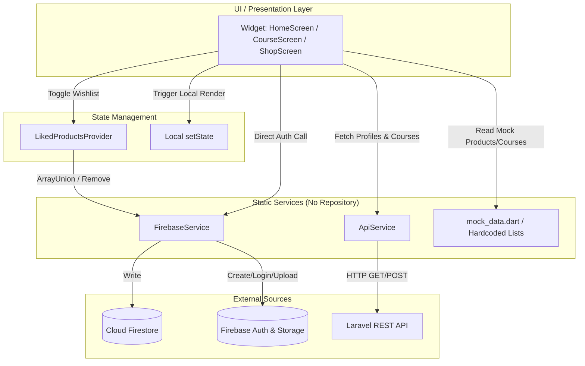
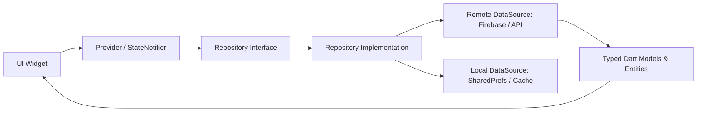

# 🏛️ Architecture Documentation — Sentient Chess

Dokumen ini mendokumentasikan arsitektur sistem, tech stack riil, pemetaan layer, pemodelan data, alur data (*data flow*), serta skema autentikasi dan error handling pada proyek **Sentient Chess**.

---

## 1. Tech Stack Overview

| Komponen | Teknologi & Versi | Catatan Implementasi |
| :--- | :--- | :--- |
| **Framework** | **Flutter 3.x** | Platform target: Android & iOS (desktop & web scaffolds tersedia). |
| **Dart SDK** | `^3.7.2` (pubspec) / `3.7.0` (Environment) | *Catatan dev*: Terdapat sedikit gap versi antara Dart SDK lokal (`3.7.0`) dengan constraint pubspec (`^3.7.2`) yang perlu diselaraskan (`>=3.7.0 <4.0.0`). |
| **State Management** | **Provider** (`^6.1.1`) + Ephemeral `setState` | `LikedProductsProvider` (`ChangeNotifierProvider`) di root widget untuk wishlist; sisanya menggunakan lokal `StatefulWidget`. |
| **Backend as a Service (BaaS)** | **Firebase Suite** | - `firebase_core: ^3.6.0`<br>- `firebase_auth: ^5.3.3`<br>- `cloud_firestore: ^5.4.3`<br>- `firebase_storage: ^12.3.3`<br>- `firebase_messaging: ^15.1.3`<br>- `google_sign_in: ^6.2.1` |
| **REST API Server** | **Laravel 10/11** (`sentient-api/`) | Backend PHP/Laravel independen dengan routing API (`/routes/api.php`) dan autentikasi JWT/Sanctum. |
| **HTTP Client** | **http** (`^1.4.0`) | Digunakan di `ApiService` untuk request REST ke server lokal/ngrok. |
| **Local Persistence** | **shared_preferences** (`^2.2.2`) | Menyimpan JWT token (`'token'`), Firebase User ID (`'user_id'`), dan path avatar offline. |
| **Media & Web Player** | **youtube_player_iframe** (`^4.0.4`), **webview_flutter** (`^4.4.2`), **url_launcher** | Pemutar video YouTube interaktif di modal dialog serta peluncur link eksternal ke marketplace Tokopedia. |
| **Hardware / OS Picker** | **image_picker** (`^1.1.2`), **path_provider** (`^2.1.5`) | Mengambil gambar via kamera / galeri dan menyimpannya di direktori lokal dokumen. |
| **Internationalization** | **intl** (`^0.19.0`) | Format mata uang Rupiah (`NumberFormat.decimalPattern('id_ID')`) dan parsing tanggal. |
| **Navigation & Routing** | Flutter **Navigator 1.0** (Named Routes + Custom Route Transitions) | Rute statis di `MaterialApp.routes` dikombinasikan dengan custom transitions (`FadeRoute`, `SlideRightRoute`, `FadeScaleRoute`). |

---

## 2. Struktur Folder & Pembagian Layer (Current Architecture Reality)

### 2.1 Kondisi Riil Codebase Saat Ini: Flat Architecture (Anti-Pattern)
Saat ini, seluruh file Dart dalam proyek diletakkan langsung di dalam direktori `lib/` tanpa pembagian subfolder:

```text
lib/
├── account_info_sheet.dart       # UI: BottomSheet info akun
├── animated_route.dart           # Navigation: Custom PageRouteBuilder (Fade, Slide, Scale)
├── api_service.dart              # Data: Client REST API (Laravel backend)
├── article_detail_screen.dart    # UI: Halaman detail artikel
├── course_detail_screen.dart     # UI: Halaman detail kursus & kurikulum
├── course_screen.dart            # UI: Halaman katalog kursus & filter (1148 baris)
├── cta_screen.dart               # UI: Call-to-Action screen onboarding
├── edit_profile_sheet.dart       # UI: BottomSheet ubah username, telepon, avatar
├── firebase_service.dart         # Data: Service integrasi Firebase (Auth, Firestore, Storage)
├── home_screen.dart              # UI: Dashboard utama, header, event, courses, shop, article (2024 baris)
├── liked_products_provider.dart  # State: Provider sinkronisasi wishlist dengan Firestore
├── liked_products_screen.dart    # UI: Halaman wishlist favorit pengguna
├── login_screen.dart             # UI: Layar login form
├── main.dart                     # Entry point: Firebase init, Provider wrapper, Route map
├── mock_data.dart                # Data: Mock list produk statis
├── product_card.dart             # UI: Reusable card produk catur
├── product_detail_screen.dart    # UI: Detail produk, pemilihan ukuran & link Tokopedia
├── profile_screen.dart           # UI: Layar profil akun pengguna
├── shop_screen.dart              # UI: Katalog toko, search bar & filter kategori
├── signup_choice_screen.dart     # UI: Pilihan registrasi
├── signup_screen.dart            # UI: Formulir registrasi lengkap & avatar picker
├── splash_screen.dart            # UI: Layar splash animasi & auth check
├── subscription_screen.dart      # UI: Layar paket keanggotaan/langganan
├── verify_email_screen.dart      # UI: Layar tunggu verifikasi email Firebase
└── welcome_screen.dart           # UI: Layar selamat datang & tombol Google Auth
```

### 2.2 Analisis Pola Arsitektur Saat Ini
- **Karakteristik**: Berorientasi file tunggal (*Single-Directory Flat Scripting*).
- **Kelemahan Arsitektural**:
  1. *Lack of Separation of Concerns (SoC)*: Komponen antarmuka (*presentation*), pemanggilan jaringan (*network/data*), dan manipulasi state bercampur dalam satu file.
  2. *God Widgets*: `home_screen.dart` (2024 baris) dan `course_screen.dart` (1148 baris) memuat belasan widget privat di dalam satu file, termasuk logika filtering data dan mock response tiruan.
  3. *Tightly Coupled Data Access*: Widget UI memanggil langsung method statis `FirebaseService` atau `ApiService` tanpa perantara repository atau interface abstraction.

---

## 3. Data Models & Entity Analysis

### 3.1 Temuan Penting: Ketiadaan Typed Model Classes
Pada codebase saat ini, **TIDAK DITEMUKAN satupun kelas Entity atau Data Model bertipe Dart** (seperti `class Course`, `class Product`, `class UserProfile`). Seluruh data ditransfer, dimanipulasi, dan dikonsumsi menggunakan struktur mentah `Map<String, dynamic>`.

### 3.2 Representasi Struktur Data (Implicit Schemas)

#### 1. Entity: User / Profile
Dikelola di Firestore (`users/{uid}`) dan Laravel REST API (`/api/profile`):
```dart
// Skema implisit Map<String, dynamic>
{
  'id': String,             // Firebase UID
  'username': String,       // Nama pengguna unik
  'email': String,          // Email pengguna
  'phone': String?,         // Nomor telepon (opsional)
  'avatar': String?,        // URL download Firebase Storage atau path gambar
  'liked_products': List<String>, // Array of Product IDs
  'created_at': Timestamp,  // Server timestamp pembuatan akun
  'updated_at': Timestamp,  // Server timestamp perubahan akun
  'providerIds': List<String>, // Provider autentikasi (misal: 'password', 'google.com')
}
```

#### 2. Entity: Course
Disimpan di Firestore (`courses/{id}`), Laravel API (`/api/courses`), serta hardcoded di UI:
```dart
// Skema implisit Map<String, dynamic>
{
  'id': String,             // ID kursus (misal: 'c1', 'course123')
  'title': String,          // Judul kursus catur
  'description': String?,   // Penjelasan ringkas kursus
  'content': String?,       // Materi lengkap kurikulum
  'youtube_url': String,    // Link video YouTube pembelajaran
  'price': num,             // Harga kursus (0 untuk kursus gratis)
  'rating': double,         // Rating nilai bintang (misal: 4.5, 4.8)
  'reviewCount': int,       // Jumlah ulasan dari pengguna
  'category': String,       // Kategori level ('Beginner', 'Intermediate', 'Expert', 'popular')
  'imageUrl': String,       // Asset path lokal atau URL gambar thumbnail
  'isPopular': bool?,       // Flag penanda kursus terpopuler
}
```

#### 3. Entity: Product (Shop)
Disimpan di `mock_data.dart`, Firestore (`products/{id}`), dan UI:
```dart
// Skema implisit Map<String, dynamic>
{
  'id': String,             // ID produk (misal: 'p1')
  'imageUrl': String,       // Asset path (misal: 'assets/images/product1.png')
  'name': String,           // Nama produk catur
  'subtitle': String,       // Subkategori (misal: 'Chess Board', 'Chess Items')
  'price': int,             // Harga dalam Rupiah (misal: 99999, 250000)
  'category': String,       // Kategori filter ('Chess', 'Items')
  'description': String,    // Spesifikasi & deskripsi detail produk
}
```

#### 4. Entity: Article
Disimpan di `home_screen.dart` dan Firestore (`articles/{id}`):
```dart
// Skema implisit Map<String, dynamic>
{
  'id': String,             // ID artikel
  'title': String,          // Judul artikel
  'category': String,       // Kategori ('Education', 'Strategy', 'News')
  'date': String,           // Tanggal rilis (misal: 'Oct 24, 2024')
  'author': String,         // Penulis / sumber artikel
  'imageUrl': String,       // Asset path atau URL web image
  'summary': String,        // Ringkasan isi artikel
  'content': String?,       // Isi lengkap artikel
}
```

#### 5. Entity: Enrollment
Relasi pendaftaran kursus di Firestore (`enrollments/{uid_courseId}`):
```dart
// Skema implisit Map<String, dynamic>
{
  'id': String,             // '{userId}_{courseId}'
  'user_id': String,        // UID pengguna yang mendaftar
  'course_id': String,      // ID kursus
  'status': String,         // Status belajar ('in_progress', 'completed')
  'progress': int,          // Persentase kemajuan (0 - 100)
  'enrolled_at': Timestamp, // Waktu pendaftaran
  'updated_at': Timestamp,  // Waktu update aktivitas terakhir
}
```

---

## 4. Alur Data (Data Flow Architecture)

### 4.1 Kondisi Saat Ini (Current Data Flow)
Alur data saat ini bersifat direct dan melompati layer abstraksi:



### 4.2 Target Arsitektur Standar (Recommended Target Flow)
Arsitektur yang direkomendasikan adalah **Feature-First Clean/Layered Flow**:



---

## 5. Skema Autentikasi, Network Calls, & Error Handling

### 5.1 Skema Autentikasi (Dual-Backend Analysis)
Saat ini terdapat **dua sistem autentikasi paralel** di dalam aplikasi:

1. **Firebase Authentication (Utama di UI)**:
   - Digunakan oleh `LoginScreen`, `SignUpScreen`, `WelcomeScreen`, dan `VerifyEmailScreen`.
   - Menggunakan `FirebaseAuth.instance.signInWithEmailAndPassword`, `createUserWithEmailAndPassword`, dan `GoogleSignIn`.
   - Menerapkan fitur **Email Verification**: User yang baru mendaftar tidak diizinkan masuk ke `HomeScreen` sebelum memverifikasi tautan yang dikirimkan ke email mereka.
   - Sesi login dideteksi di `SplashScreen` lewat `FirebaseAuth.instance.currentUser`.

2. **Laravel REST API JWT (Sekunder di `ApiService`)**:
   - Memiliki endpoint `/api/login` dan `/api/register` yang mengembalikan token bearer JWT.
   - Token disimpan di `SharedPreferences` dengan key `'token'`.
   - Digunakan oleh `home_screen.dart` dan `course_screen.dart` pada fungsi `ApiService.getProfile(token)`.
   - **Catatan Anomali Codebase**: Karena alur login UI saat ini menggunakan `FirebaseService`, token SharedPreferences `'token'` seringkali bernilai `null` sehingga panggilan `ApiService.getProfile(token)` gagal/di-bypass. Hal ini perlu disatukan pada roadmap refactoring mendatang.

### 5.2 Network Calls (REST API & Firebase)
- **REST Calls (`ApiService`)**:
  - Menggunakan HTTP method standar: `http.get`, `http.post`, `http.MultipartRequest` (untuk upload avatar).
  - Timeout seragam: `timeout(const Duration(seconds: 10))`.
  - Base URL terkonfigurasi dinamis ke IP LAN atau tunnel: `http://192.168.1.6:8000/api` atau via ngrok.
- **Firebase Calls (`FirebaseService`)**:
  - Direct SDK queries dengan index pengurutan: `_firestore.collection('courses').orderBy('created_at', descending: true).get()`.
  - Batching / Atomic updates pada wishlist: `FieldValue.arrayUnion([productId])` dan `FieldValue.arrayRemove([productId])`.

### 5.3 Error Handling Saat Ini
- **Pola Penanganan**:
  - Membungkus proses asinkron dalam blok `try ... catch (e)`.
  - Log error dicetak ke terminal developer menggunakan `print('Error: $e')`.
  - Nilai pengembalian (*fallback*) jika terjadi kegagalan:
    - Koleksi/list: mengembalikan list kosong `[]`.
    - Objek/dokumen: mengembalikan nilai `null`.
    - Operasi boolean: mengembalikan `false`.
- **Evaluasi Error Handling**:
  - *Silent Failure*: Pengguna sering kali tidak mendapatkan informasi spesifik jika jaringan terputus (hanya melihat spinner terus berputar atau list kosong).
  - *No Typed Exceptions*: Belum tersedia objek `Failure` atau `Result<T>` yang membedakan antara Network Failure, Auth Failure, dan Server Validation Error.
